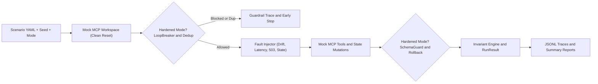

# mcp-drift-lab

**Deterministic fault-injection and reliability harness for Model Context Protocol (MCP) servers and agent toolchains.**

`mcp-drift-lab` helps engineering teams, platform builders, and reliability researchers test how AI agent toolchains behave when upstream tools drift, slow down, fail transiently, or leave partial state changes behind. Instead of relying on one-off demos or brittle live environments, every run executes deterministically from a seed and compares `baseline` (unmitigated) behavior against `hardened` (guardrail-enforced) behavior.

---

## Why This Matters for Evaluators and Reliability Teams

Real-world tool integrations rarely fail in clean, textbook ways. A tool renames a field, drops a required status key, introduces tail latency, returns `503` on the first attempt, or errors out after mutating state in an earlier step.

`mcp-drift-lab` makes those failure modes repeatable, measurable, and inspectable:

- **Seeded Determinism**: Re-run the exact same scenario and seed across commits, guardrail policies, or model/toolchain changes to get consistent, auditable results.
- **Paired Baseline vs. Hardened Benchmarks**: Evaluate identical runs with guardrails off (`baseline`) and on (`hardened`) to quantify reliability lift, state safety, and latency/call overhead.
- **Invariant-First Verification**: Separate surface task completion from system safety using explicit invariant checks (`max_retries`, `max_tool_calls`, `no_uncompensated_mutations`, `allowed_tools_only`, `required_tools_called`, and `state_equals`).
- **Cloud & CI Ready**: Designed to run smoothly in cloud sandboxes or GitHub Actions (`eval-gate.yml`) without requiring a local Python installation on your laptop.

---

## Execution & Evaluation Flow

## Benchmark Snapshot (Baseline vs. Hardened)

Running `mcp-drift run` across deterministic seeds (`42`, `101`) lets you compare unmitigated (`baseline`) execution against guardrail-enforced (`hardened`) execution on the same scenario and seed.

> Replace the values below with your latest `artifacts/summary.md` output after running the evaluation gate in CI or your cloud workspace.

| Scenario | Mode | Runs | Task Completion | Invariant Pass Rate | Clean State Rate | Avg Latency (ms) | Guardrail Interventions |
| --- | --- | ---: | ---: | ---: | ---: | ---: | ---: |
| `config_patch_01` | `baseline` | 2 | — | — | — | — | 0 |
| `config_patch_01` | `hardened` | 2 | — | — | — | — | — |
| `incident_triage_01` | `baseline` | 2 | — | — | — | — | 0 |
| `incident_triage_01` | `hardened` | 2 | — | — | — | — | — |
| `partial_state_flag_01` | `baseline` | 2 | — | — | — | — | 0 |
| `partial_state_flag_01` | `hardened` | 2 | — | — | — | — | — |
| `schema_drift_health_01` | `baseline` | 2 | — | — | — | — | 0 |
| `schema_drift_health_01` | `hardened` | 2 | — | — | — | — | — |
| `ticket_escalation_01` | `baseline` | 2 | — | — | — | — | 0 |
| `ticket_escalation_01` | `hardened` | 2 | — | — | — | — | — |

### What to Look For When Interpreting Results

- **Task Completion vs. Invariant Pass Rate**: A run can finish its planned steps while still failing an invariant (for example, exceeding retry/call bounds or leaving an uncompensated state mutation).
- **Guardrail Trade-Offs**: Stopping a looping call or rolling back a partial state change may end a run early rather than forcing completion—which is often safer than silent corruption or runaway retries.

- ## License

This project is licensed under the [Apache License 2.0](LICENSE).
